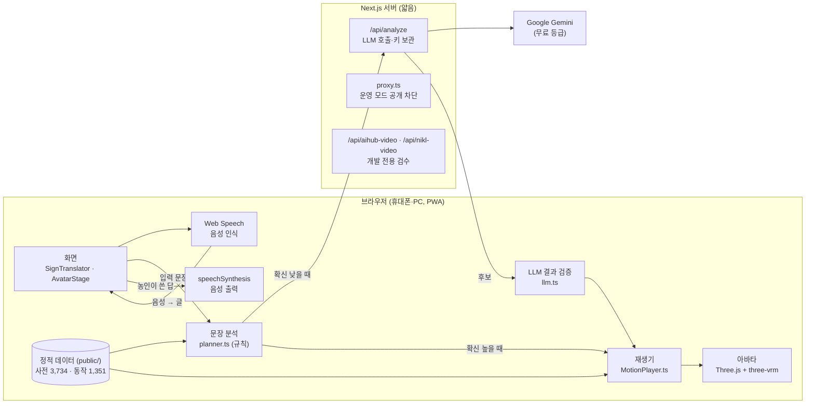
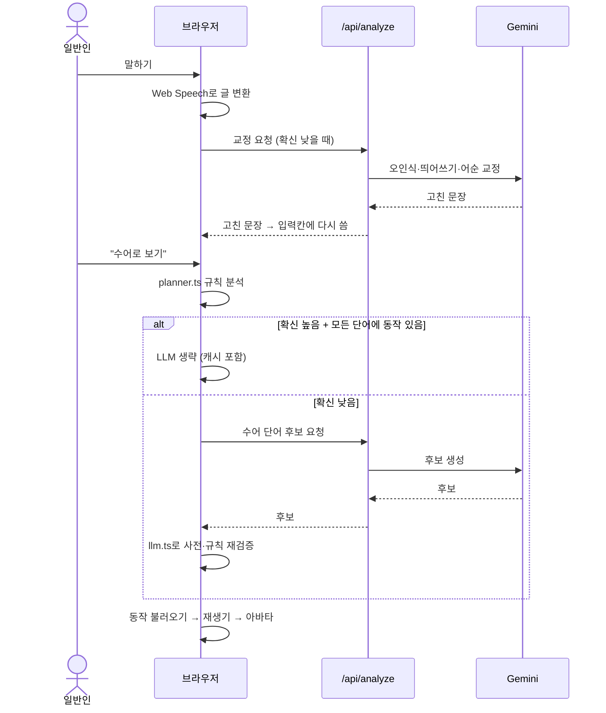
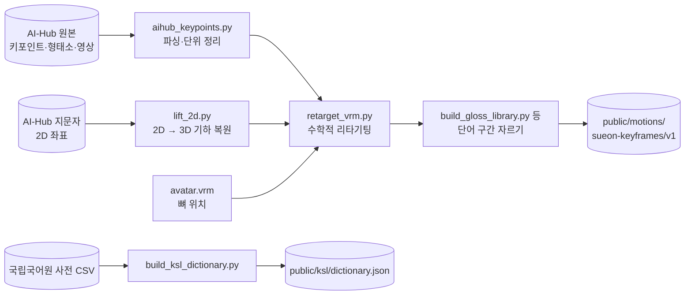
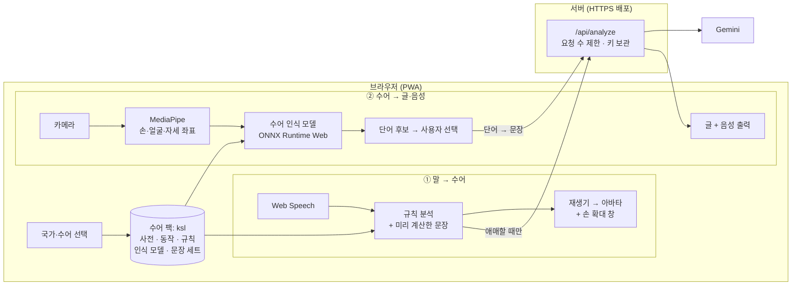
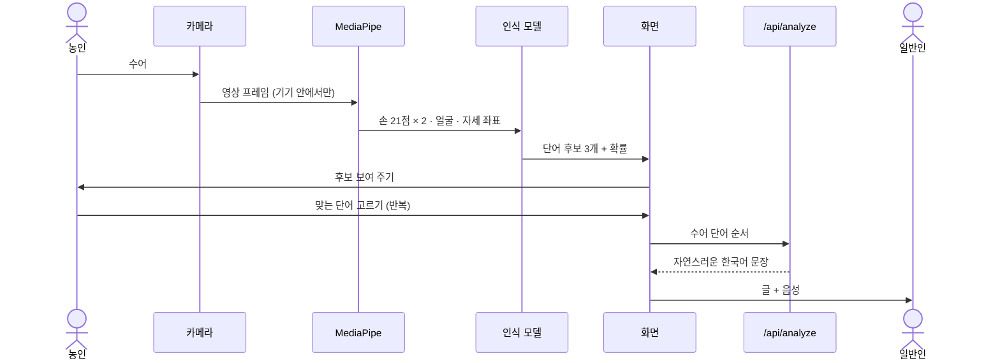
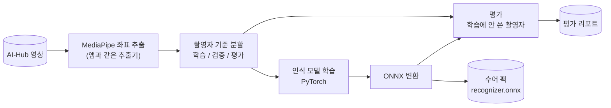
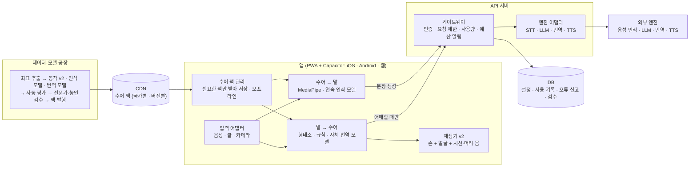
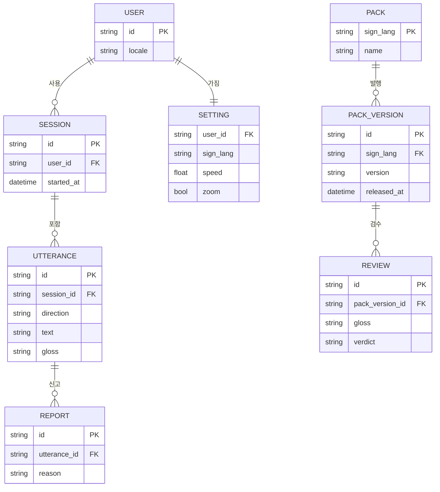

# SUEO:N(수어온) 시스템 아키텍처

> 문서 버전: v0.1 / 수정일: 2026-11-26
> 관련 문서: [ARCHITECTURE.md](../ARCHITECTURE.md)(알고리즘·데이터 형식 상세), [DEV_WORKFLOW.md](DEV_WORKFLOW.md)(개발 방식), [CREDITS.md](../CREDITS.md)(출처·라이선스)

이 문서는 수어온을 **어떤 구성 요소로, 어떤 흐름으로** 만드는지 정의한다. 지금 구현된 구조(v0.1)와 앞으로 갈 구조(v0.2, v1.0)를 나눠 적는다. 알고리즘 내부(문장 분석 7단계, 리타기팅 수식, 데이터 형식 필드)는 [ARCHITECTURE.md](../ARCHITECTURE.md)가 기준이고, 여기서는 이름만 참조한다.

| 단계 | 상태 | 한 줄 요약 |
|---|---|---|
| **v0.1** | 구현됨 | 말·글 → 한국수어 아바타 (한 방향) |
| **v0.2** | 계획 | 양방향(카메라 수어 인식 추가) + 수어 팩(국가 키) |
| **v1.0** | 계획 | 앱 배포, 엔진 교체 가능 서버, 수어 팩 배포 |

---

## 목차

| 절 | 내용 |
|---|---|
| 1 | 설계 원칙 |
| 2 | v0.1 현재 아키텍처 |
| 3 | v0.2 다음 단계 아키텍처 |
| 4 | v1.0 서비스 아키텍처 |
| 5 | 단계별 비교 |
| 6 | 엔진·도구 선택 |
| 7 | 지금 코드에서 바뀌는 부분 |

---

## 1. 설계 원칙

| 원칙 | 적용 | 시작 |
|---|---|---|
| 동작은 생성하지 않고 실제 촬영을 옮긴다 | 수어 동작은 실제 농인 촬영 좌표를 수학적으로 리타기팅한 것만 쓴다. 근거 없는 동작을 만들지 않는다 | v0.1 |
| 규칙이 먼저, LLM은 보조 | 문장 분석은 규칙·사전이 기본이다. LLM 결과는 후보일 뿐이고 규칙·사전이 다시 검증한다 | v0.1 |
| 무거운 처리는 앱 밖에서 | 원본 데이터 가공은 Python 오프라인 파이프라인에서 하고, 앱에는 결과 JSON만 넣는다 | v0.1 |
| 기기 우선 | 자주 쓰는 경로(분석·재생·인식)는 기기 안에서 처리한다. 외부 API는 예외일 때만 부른다. 속도·비용·개인정보를 함께 줄인다 | v0.1 → v0.2 확대 |
| 양방향은 같은 구조의 두 길 | 말 → 수어, 수어 → 글·음성을 같은 단계 구조(입력 → 해석 → 표현)로 만든다 | v0.2 |
| 수어 종류는 입구에서 갈린다 | 사전·동작·규칙·인식 모델을 **수어 팩**으로 묶고 국가 키(`ksl`, `asl` …)로 고른다 | v0.2 |
| 외부 엔진은 교체 가능하게 | 음성 인식·LLM·번역·TTS는 인터페이스 하나 뒤에 두고 환경변수로 고른다 (지금 LLM 공급자 방식을 확대) | v0.1 → v1.0 확대 |
| 품질은 숫자로 | 정확도는 학습에 쓰지 않은 촬영자·문장으로 자동 채점하고, 검증하지 않은 정확성은 주장하지 않는다 | v0.2 |

---

## 2. v0.1 현재 아키텍처

### 2.1 시스템 구성



| 구성 요소 | 역할 | 위치 |
|---|---|---|
| 화면 | 입력, 음성 버튼, 말풍선, 재생 제어, 손 확대 | `src/components/SignTranslator.tsx`, `AvatarStage.tsx` |
| 음성 인식 | 말 → 글. 끝나면 LLM이 교정한 문장을 입력칸에 다시 씀 | 브라우저 Web Speech |
| 문장 분석 | 정리 → 형태 → 오타 → 의미 → 동작 연결 → 어순 → 확신도 | `src/lib/ksl/planner.ts` |
| LLM 계층 | 확신이 낮은 문장만 후보 요청. 공급자는 환경변수로 선택 (`gemini` / `anthropic` / `openai` / `mock`) | `src/lib/ksl/llm.ts`, `llmProviders.ts`, `/api/analyze` |
| 재생기 | 단어 동작을 리드인·핵심 구간으로 이어 재생 | `src/lib/MotionPlayer.ts` |
| 아바타 | VRM 1.0 렌더링, 의문문 눈썹 표정(규칙) | `AvatarStage.tsx` |
| 정적 데이터 | 사전, 동작 사전, 동작 클립. **DB 없음** | `public/ksl/`, `public/motions/` |
| 서버 | 키 숨기기, 개발 전용 검수 영상, 운영 모드 차단 | `src/app/api/*`, `src/proxy.ts` |

### 2.2 말 → 수어 흐름



### 2.3 데이터 파이프라인 (오프라인)



### 2.4 한계

| 한계 | 원인 | 해결 단계 |
|---|---|---|
| 한 방향뿐 (말 → 수어) | 수어 → 글 경로 없음. 농인은 글로만 답함 | v0.2 |
| 애매한 문장은 2~3초 대기 | LLM 호출을 기다림 | v0.2 (미리 계산), v1.0 (자체 번역 모델) |
| 얼굴 문법 없음 | 동작 형식이 뼈 회전뿐, 아바타 표정이 적음 | v1.0 (동작 v2) |
| 한국수어만 | 사전·동작·규칙에 수어 종류 구분 없음 | v0.2 (수어 팩) |
| 공개 서비스 불가 | 배포·요청 제한·인증 없음 | v0.2 (시연용 배포), v1.0 |

---

## 3. v0.2 다음 단계 아키텍처

> 계획. 구현되지 않은 부분이다.

### 3.1 시스템 구성



| 추가·변경 | 내용 | 이유 |
|---|---|---|
| 국가·수어 선택 | 시작할 때 고름. 기본값 한국 / 한국수어 | 다른 나라 수어로 확장할 때 구조를 다시 만들지 않기 위해 |
| 수어 팩 | 사전·동작·규칙·인식 모델·문장 세트를 수어 종류별 묶음으로 | 위와 같음 |
| 수어 → 글·음성 경로 | 카메라 → MediaPipe → 인식 모델 → 후보 → 문장 → 음성 | 농인도 자기 언어로 말할 수 있게 (양방향 대화) |
| 미리 계산한 문장 | 정해 둔 대화 문장의 분석 결과를 팩에 넣어 둠 | LLM 대기 없이 즉시 재생 |
| 손 확대 창 | 손 부분을 크게 보여 주는 별도 창 | 손 모양 확인 |
| HTTPS 배포 + 요청 수 제한 | 아이폰·Wi-Fi에서 마이크·카메라 사용 | 브라우저가 HTTPS에서만 카메라·마이크를 허용 |

### 3.2 수어 → 글·음성 흐름



- 영상은 서버로 보내지 않는다. 좌표 추출과 인식은 기기 안에서 끝난다.
- 처음에는 **단어 단위** 인식, 정해 둔 대화에 필요한 단어부터 시작한다. 연속 문장 인식은 v1.0 목표다.

### 3.3 수어 팩 구조

```text
public/packs/
  index.json                 사용 가능한 팩 목록 (국가 키, 이름, 버전)
  ksl/                       한국수어
    pack.json                메타: 언어, 버전, 출처, 라이선스
    dictionary.json          사전
    motions/                 동작 클립 + index.json
    rules.json               어순·표현 규칙 설정 (코드 규칙과 분리 가능한 부분)
    recognizer.onnx          수어 인식 모델
    scenarios.json           미리 계산한 대화 문장
  asl/                       (예정) 미국수어
```

| 연결 고리 | v0.1 | v0.2 |
|---|---|---|
| 글 → 수어 단어 | `(한국어 표현) → 동작` | `(국가 키, 표현) → 동작` |
| 동작 클립 | 경로만 | `sign_lang` 필드 추가 |
| 인식 결과 | 없음 | `(국가 키, 인식 단어) → 표현` |
| 화면 | 한국 고정 | 선택한 팩 사용 |

### 3.4 데이터·모델 파이프라인



- 학습과 실제 사용이 **같은 추출기(MediaPipe)**를 쓰게 해서 좌표 차이를 없앤다.
- 기존 리타기팅 파이프라인(2.3절)은 그대로 둔다.

---

## 4. v1.0 서비스 아키텍처

> 계획. 방향을 정해 두기 위한 목표 구조다.

### 4.1 시스템 구성



| 구성 요소 | 역할 |
|---|---|
| 앱 | 웹과 같은 코드로 앱스토어 배포. 카메라·마이크 권한 안정 |
| 수어 팩 관리 | 고른 나라의 팩만 받아 기기에 저장. 네트워크 없이도 기본 기능 동작 |
| 자체 번역 모델 | 한국어 ↔ 수어 단어 순서를 학습한 작은 모델. LLM 없이 빠르게 변환 |
| 재생기 v2 | 동작 형식 v2(뼈 회전 + 얼굴 표정값 + 시선·머리·몸) 재생. v1 동작도 계속 재생 |
| 게이트웨이 | 로그인, 요청 수 제한, 사용량 집계, 예산 알림 (과금 사고 방지) |
| 엔진 어댑터 | 외부 엔진을 환경변수로 교체. 공급자가 바뀌어도 앱은 그대로 |
| DB | 사용자 설정, 사용 기록, 잘못된 수어 신고, 검수 판정 |
| 데이터·모델 공장 | 새 데이터 → 동작·모델 생성 → 자동 채점 → 사람 검수 → 팩 버전 발행 |

### 4.2 데이터 모델 (초안)



- 대화 내용(`UTTERANCE`)은 사용자가 동의한 경우에만 저장한다.

---

## 5. 단계별 비교

| 영역 | v0.1 (현재) | v0.2 (다음) | v1.0 (서비스) |
|---|---|---|---|
| 방향 | 말 → 수어 | **양방향** | 양방향 |
| 수어 종류 | 한국수어 고정 | 수어 팩 구조 (ksl) | 팩 여러 개, CDN 배포 |
| 말 → 수어 변환 | 규칙 + LLM | 규칙 + 미리 계산 + LLM | 형태소 분석기 + 규칙 + 자체 번역 모델, LLM은 예외 |
| 수어 → 말 | 없음 (글 입력) | 단어 인식 + 후보 선택 | 연속 문장 인식 |
| 직접 학습한 모델 | 없음 | 수어 인식 모델 | 인식 + 번역 모델 |
| 아바타 표현 | 손·팔·상체, 의문문 눈썹(규칙) | 같음 + 손 확대 창 | 얼굴·시선·머리·몸 (동작 v2) |
| 서버 | API 4개, 공개 차단 | HTTPS 배포, 요청 제한 | 게이트웨이 + 엔진 어댑터 |
| 데이터 저장 | 정적 JSON | 정적 JSON (팩 구조) | 정적 팩 + DB |
| 앱 | PWA (로컬 실행) | PWA (HTTPS) | PWA + 앱스토어 |
| 품질 확인 | 팀 자체 판정 | 촬영자 분리 자동 평가 | 자동 평가 + 전문가·농인 검수 |

---

## 6. 엔진·도구 선택

| 기능 | v0.1 · v0.2 | v1.0 후보 | 선택 기준 |
|---|---|---|---|
| 카메라 좌표 | MediaPipe (v0.2) | MediaPipe, 정확도 보강이 필요하면 RTMPose | 기기 실시간, 상업 이용 가능(Apache 2.0). OpenPose는 상업 이용이 유료라 제외 |
| 얼굴 표정값 | — | MediaPipe 얼굴 표정값 52개 → VRM 표정 | 같은 체계라 바로 연결 |
| 수어 인식 | 좌표 + 작은 학습 모델, ONNX Runtime Web | 같은 구조, 데이터 확대, 연속 인식 | 한국수어 상용 인식 API가 사실상 없음. 기기 실행 |
| 음성 인식 | Web Speech | CLOVA Speech / Google Cloud STT / Whisper | 한국어 정확도, 실시간, 비용 |
| 형태소 | 규칙 | Kiwi / Komoran + 규칙 | 정확도, 상업 이용 가능 라이선스 |
| LLM | Gemini 무료 등급 | Gemini 유료 / HyperCLOVA X | 무료 등급은 입력이 서비스 개선에 쓰여 서비스용으로 부적합 |
| 번역 | Gemini | Papago / Google 번역 / DeepL | 속도, 예측 가능한 비용 |
| TTS | 브라우저 내장 | CLOVA Voice / Google Cloud TTS | 목소리 품질 |
| 아바타 | VRM 샘플 | 자체 VRM (표정 52개 포함) | 엔진 유지, 얼굴 문법 표현 |
| 앱 | PWA | PWA + Capacitor | 같은 코드로 앱스토어 |
| 배포 | Vercel 무료 (시연용) | 상업용 요금제 + CDN | 무료 요금제는 비상업용 |

> 라이선스와 요금은 도입하기 전에 각 공급자의 최신 약관으로 다시 확인한다.

---

## 7. 지금 코드에서 바뀌는 부분

| 현재 | 바뀌는 방식 | 단계 |
|---|---|---|
| `public/ksl/`, `public/motions/` | `public/packs/ksl/…`로 묶고 국가 키 추가. 옛 경로는 옮기는 동안 함께 유지 | v0.2 |
| `planner.ts` | 한국수어 팩의 규칙으로 위치를 정리. 다른 수어는 별도 규칙 | v0.2 (구조) |
| `SignTranslator.tsx` (한 방향) | 대화 화면: 말하는 사람(일반인 / 농인) 전환 | v0.2 |
| (없음) | `src/lib/recognition/` 카메라·MediaPipe·인식 모델 | v0.2 |
| (없음) | `scripts/` 좌표 추출·학습·평가 스크립트 | v0.2 |
| `llmProviders.ts` (LLM 교체) | 같은 방식을 음성 인식·번역·TTS로 확대 | v1.0 |
| `MotionPlayer.ts` (뼈 회전) | 동작 v2 재생(얼굴·시선 채널), v1 동작 계속 지원 | v1.0 |
| `proxy.ts` (공개 차단) | 인증·요청 제한으로 대체 | 공개 배포 시 |
